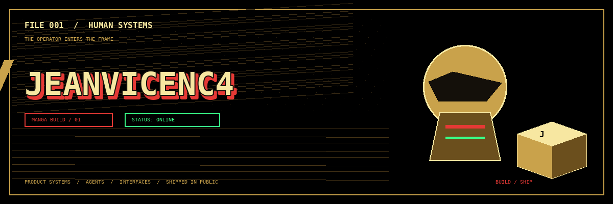
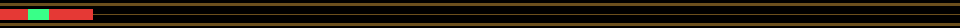
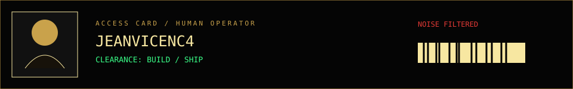
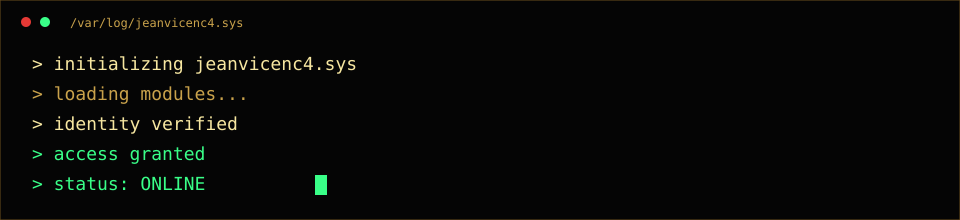
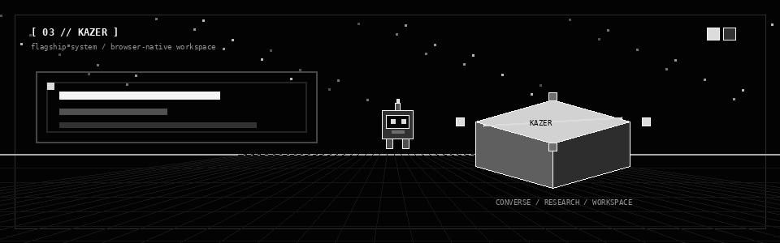
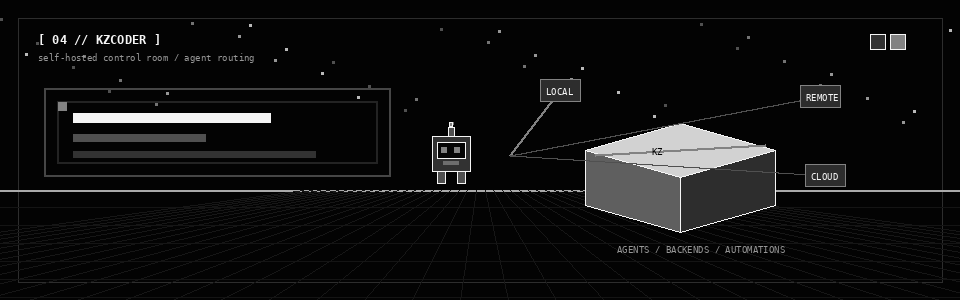
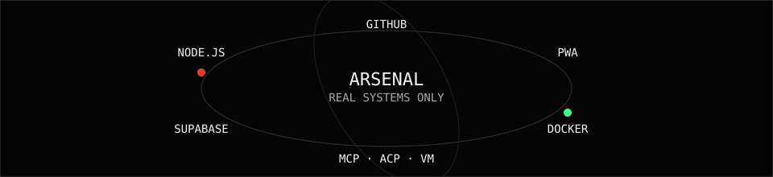
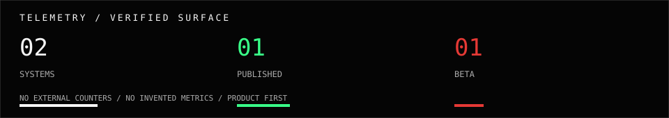
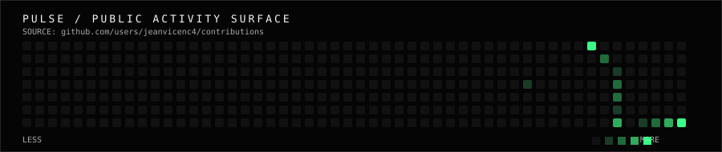
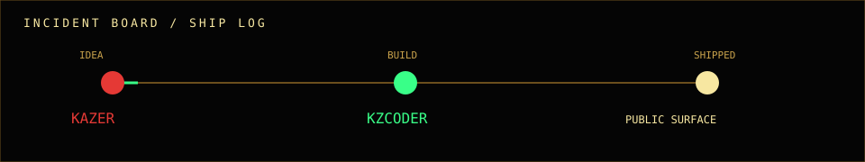

  <picture>
    <source media="(prefers-color-scheme: dark)" srcset="./assets/identity-hero.gif">
    <source media="(prefers-color-scheme: light)" srcset="./assets/identity-hero.gif">
    
  </picture>

  <strong>JEANVICENC4</strong> 
  human systems / agents / interfaces / shipped in public

  <a href="#01--identity">IDENTITY</a> ·
  <a href="#03--kazer">KAZER</a> ·
  <a href="#04--kzcoder">KZCODER</a> ·
  <a href="#08--transmission-log">LOG</a>

## [ 01 // IDENTITY ]

I turn ideas into operating software.

No generic project wall. Just two systems I am actually building, a public surface, and the machinery behind it.

  

## [ 02 // SYSTEM BOOT ]

  

## [ 03 // KAZER ]

> **The workspace layer.** Conversa, pesquisa e workspace em um espaço web/PWA em português.

  <picture>
    <source media="(prefers-color-scheme: dark)" srcset="./assets/kazer-flagship.gif">
    <source media="(prefers-color-scheme: light)" srcset="./assets/kazer-flagship.gif">
    
  </picture>

[**Open KAZER →**](https://kazer.vercel.app) · [repository and docs](https://github.com/jeanvicenc4/KAZER)

- **Brain server-side:** conversation routing between configured providers, with server-side validation.
- **Research + attachments:** web research and source synthesis, with documented flows for images, PDF, DOCX and text/code.
- **Connected workspace:** tasks, MCP connectors, GitHub OAuth, Google Drive and PWA installation.

`STATUS / PUBLISHED` · `SCOPE / WEB + PWA` · `LICENSE / PROPRIETARY CODE`

## [ 04 // KZCODER ]

> **The control layer.** A self-hosted developer control center for coding agents and automations.

  <picture>
    <source media="(prefers-color-scheme: dark)" srcset="./assets/kzcoder-flagship.gif">
    <source media="(prefers-color-scheme: light)" srcset="./assets/kzcoder-flagship.gif">
    
  </picture>

[**Open Kzcoder →**](https://github.com/jeanvicenc4/Kzcoder) · [backend documentation](https://docs.openhands.dev/openhands/usage/agent-canvas/backends)

- **Self-host your way:** local, Docker, VM or company infrastructure.
- **Switch backends:** move between local, remote and cloud agents from the same interface.
- **Automate the work:** workflows that integrate with Slack, GitHub and Linear through schedules or webhooks.

`STATUS / BETA` · `SCOPE / SELF-HOSTED` · `AGENTS / OPENHANDS · CLAUDE CODE · CODEX · GEMINI · PI · OPENCODE`

## [ 05 // ARSENAL ]

The stack is not decoration. These are the pieces documented around the two systems.

  

## [ 06 // TELEMETRY ]

  

02 systems. 01 published. 01 beta. No invented metrics.

## [ 07 // PULSE ]

  

The pulse is generated from GitHub's public contribution calendar and refreshed by a repository workflow. It is activity, not a vanity score.

## [ 08 // TRANSMISSION LOG ]

<strong>2026.10.16 / KAZER / PRESSURE TEST</strong>

KAZER's latest documented pass stayed close to the device: SVG tooling, duotone, DPI, packaging and storefront pieces. The changelog is explicit about what did not move: `interface/`, `api/` and `database/` stayed untouched.

<strong>2025.05.11 / KZCODER / ALPHA SIGNAL</strong>

Kzcoder's `1.0.0-alpha.2` shipped the npm package, local CLI, library mode, subpath exports and GitHub Actions publishing. Small release. Serious direction.

[read KAZER changelog](https://github.com/jeanvicenc4/KAZER/blob/main/CHANGELOG.md) · [read Kzcoder changelog](https://github.com/jeanvicenc4/Kzcoder/blob/main/CHANGELOG.md)

  

## [ 09 // SIGNAL ]

<strong>Built in the dark. Shipped in public.</strong> systems over noise

