  <picture>
    <source media="(prefers-color-scheme: dark)" srcset="./assets/hero-dark.svg">
    <source media="(prefers-color-scheme: light)" srcset="./assets/hero-light.svg">
    
  </picture>

  
  

<b>Construo agentes, automações e produtos digitais direto do celular.</b> Transformo ideias em ferramentas úteis para resolver problemas reais.

  <a href="#-sobre-mim">IDENTIDADE</a> ·
  <a href="#-arsenal">ARSENAL</a> ·
  <a href="#️-projetos-em-campo">PROJETOS</a> ·
  <a href="#️-domain-expansion-code-mode">DOMAIN EXPANSION</a> ·
  <a href="#-quests">QUESTS</a>

---

### 🧠 Sobre mim

Sou **Jeanvicenc4**: criador de agentes de IA, engenheiro de prompts e desenvolvedor focado em automações e produtos digitais. Construo principalmente pelo celular, explorando ferramentas fortes para tirar ideias do papel, resolver problemas reais e criar soluções com potencial de gerar receita.

Meu foco é combinar **IA + software + execução** — do prompt ao produto, com curiosidade de builder e mentalidade de quem prefere publicar algo funcional a ficar só no plano.

### 🧰 Arsenal

*HUD de habilidades — áreas de atuação, não uma escala de proficiência.*

| SLOT | SKILL |
|:--|:--|
| `01 / INTELLIGENCE` | IA · Agentes · Prompt engineering |
| `02 / AUTOMATION` | Automação · n8n · APIs |
| `03 / BUILD` | Python · JavaScript |
| `04 / MOBILE` | Android · desenvolvimento mobile pelo celular |
| `05 / DEPLOY` | Produtos e ferramentas digitais |

  
  
  
  
  
  
  
  

### ⚙️ Projetos em campo

<table>
  <tr>
    <td width="50%" valign="top">
      <a href="https://github.com/jeanvicenc4/KAZER"><b>🟥 KAZER</b></a> 
      Espaço web/PWA de conversa com IA, pesquisa, workspace e integrações. Projeto em desenvolvimento ativo.  
      
    </td>
    <td width="50%" valign="top">
      <a href="https://github.com/jeanvicenc4/Kzcoder"><b>⬛ Kzcoder</b></a> 
      Central self-hosted para controlar agentes de programação e automações, com backends locais, remotos e cloud.  
      
    </td>
  </tr>
  <tr>
    <td colspan="2" align="center">
      <a href="https://github.com/jeanvicenc4/KAZER.V1"><b>⬜ KAZER.V1</b></a> · Repositório separado da versão V1: plataforma de IA para pesquisa, execução e criação.
    </td>
  </tr>
</table>

<a href="https://github.com/jeanvicenc4?tab=repositories"><b>VER REPOSITÓRIOS ↗</b></a>

### 📡 Telemetria

  
  

  

  

  

Os cards dependem de serviços externos e refletem dados públicos do GitHub; se algum ficar indisponível, os links acima continuam levando aos repositórios.

### ⚔️ Domain Expansion: Code Mode

  

<b>DOMAIN: CODE MODE</b> · <code>IDEA → BUILD → SHIP</code> Energia original feita em SVG para este perfil — sem personagens ou arte de Jujutsu Kaisen.

### 🐍 Contribution snake

<picture>
  <source media="(prefers-color-scheme: dark)" srcset="https://raw.githubusercontent.com/jeanvicenc4/jeanvicenc4/output/github-contribution-grid-snake-dark.svg">
  <source media="(prefers-color-scheme: light)" srcset="https://raw.githubusercontent.com/jeanvicenc4/jeanvicenc4/output/github-contribution-grid-snake.svg">
  
</picture>

### 🎯 Quests

- `QUEST 01` Criar agentes de IA que resolvam problemas reais.
- `QUEST 02` Automatizar processos usando n8n e APIs.
- `QUEST 03` Construir apps e ferramentas direto do celular.
- `QUEST 04` Criar produtos digitais úteis e sustentáveis.
- `QUEST 05` Aprofundar engenharia de prompts e sistemas com IA.

### 📬 Contato

  
  

<!-- UPDATES:START -->
<!-- UPDATES:END -->

Built in the dark. Shipped in public. · Systems over noise.

