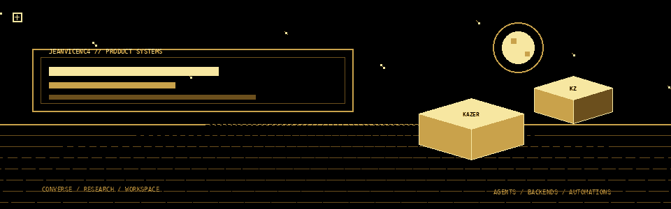
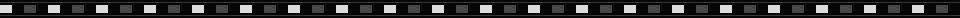
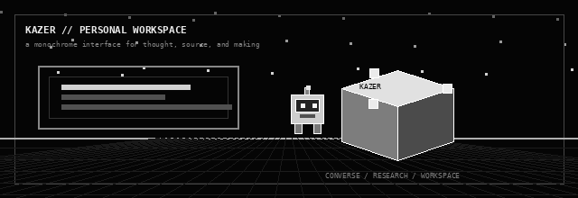
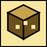
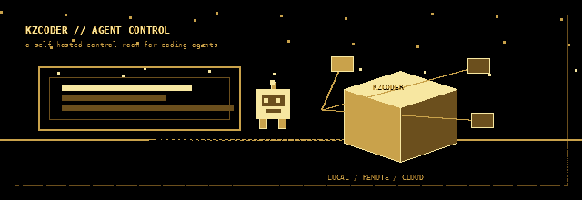
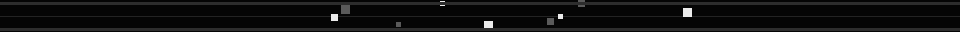
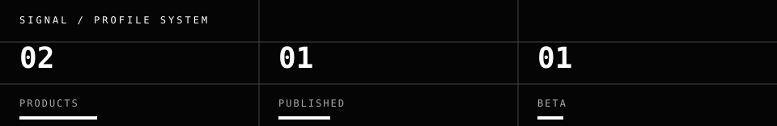

  <picture>
    <source media="(prefers-color-scheme: dark)" srcset="./assets/hero.gif">
    <source media="(prefers-color-scheme: light)" srcset="./assets/hero.gif">
    
  </picture>

  <strong>JEANVICENC4</strong> 
  product systems · agents · interfaces que fazem o trabalho aparecer

  <a href="#produtos">PRODUTOS</a> ·
  <a href="#updates">UPDATES</a> ·
  <a href="#signal">SIGNAL</a>

  

## Produtos

Dois produtos, duas camadas do mesmo sistema: uma superfície para pensar e uma central para fazer agentes rodarem.

###  KAZER

> **Conversa, pesquisa e workspace em um espaço web/PWA em português.**

[**Abrir KAZER →**](https://kazer.vercel.app) · [código e documentação](https://github.com/jeanvicenc4/KAZER)

  

- **Brain server-side:** roteia a conversa entre provedores configurados e mantém validações no servidor.
- **Pesquisa + anexos:** pesquisa e síntese de fontes, com fluxo documentado para imagens, PDF, DOCX e texto/código.
- **Workspace conectado:** tarefas, conectores MCP, GitHub OAuth, Google Drive e instalação como PWA.

`STATUS / publicado` · `ESCOPO / web + PWA` · `LICENÇA / código proprietário`

###  Kzcoder

> **Central self-hosted para controlar agentes de código e automações.**

[**Abrir Kzcoder →**](https://github.com/jeanvicenc4/Kzcoder) · [docs de backends](https://docs.openhands.dev/openhands/usage/agent-canvas/backends)

  

- **Backends sob seu controle:** roda localmente, em Docker, VM ou infraestrutura da empresa.
- **Troca sem perder o foco:** alterna entre agentes locais, remotos e cloud pela mesma interface.
- **Automação de verdade:** workflows integráveis com Slack, GitHub e Linear, por agenda ou webhook.

`STATUS / beta` · `ESCOPO / self-hosted` · `AGENTES / OpenHands · Claude Code · Codex · Gemini · Pi · OpenCode`

  

## Updates

Registro curto, editável e baseado nos changelogs públicos dos produtos.

- **16 out 2026 · KAZER — Unreleased** — pesquisa/prensa no aparelho: SVG, duotone, DPI, molde simples de caixa e peças de vitrine; o changelog registra que nenhum arquivo de `interface/`, `api/` ou `database/` foi alterado.
- **11 mai 2025 · Kzcoder — 1.0.0-alpha.2** — primeiro release do pacote npm `@openhands/agent-canvas`, CLI local, modo library, subpath exports e publicação via GitHub Actions.

[ver changelog do KAZER](https://github.com/jeanvicenc4/KAZER/blob/main/CHANGELOG.md) · [ver changelog do Kzcoder](https://github.com/jeanvicenc4/Kzcoder/blob/main/CHANGELOG.md)

## Signal

  

Este perfil privilegia produto verificável: sem badges externos, sem contadores dinâmicos e sem claims que o código não sustenta.

  

black / white / shipped

